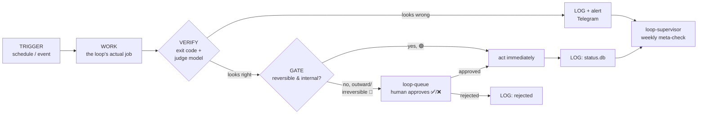

# agent-loops

**A harness for running autonomous agent loops safely: every loop is watched, every
outward action is gated, every filter has an exam it can fail.**

This repository is extracted from a personal production setup that has been running
autonomous and semi-autonomous agent loops on a Mac mini under `launchd` since mid-2026.
It is not a framework or a library to `pip install` — it's a working reference for a
specific, opinionated answer to "how do you let an agent run unattended without it
quietly rotting or doing something irreversible."

## What it is

Every loop in this repo follows the same five-part anatomy:

```
TRIGGER → WORK → VERIFY → GATE → LOG
 (when)   (what)  (right?) (out?) (visible?)
```

Most "automation" stops at TRIGGER → WORK → maybe a LOG. The two parts that are usually
missing — and the two that actually make unattended operation safe — are **VERIFY**
(did the work actually do the right thing, not just exit 0?) and **GATE** (does this
result get to act on the world immediately, or does a human see it first?). This repo is
the infrastructure for those two parts, applied consistently across every loop:



### Components

| Directory | Role | Phase |
|---|---|---|
| `loop-status/` | Observability foundation: every run's status.db entry, the `loop-run.sh` wrapper every scheduled task runs through, a watchdog for silence, a judge model that checks *substance* not just exit code, and a self-grading layer for artifact quality. | P0 |
| `loop-queue/` | The human-approval gate: a SQLite queue of outward-facing proposals + a Telegram bot with ✅/❌ buttons. A worker executes approved items as an argv list — never through a shell. | P1 |
| `loop-supervisor/` | A weekly meta-check over the whole harness: scheduler drift, run-status regressions, queue health, disk, knowledge-base liveness, doc drift. Never fixes anything — only reports. | P3 |
| `loop-synthesis/` | Turns a week of raw feed digests into one curated, actionable insight via a cheap model. Internal and reversible, so it runs with no approval gate. | P4 |
| `loop-evals/` | A golden-set "exam" for a loop's filter/prompt, run through the loop's *actual* code (an imported function, not a re-implemented prompt), with a recorded baseline accuracy. | P5 |
| `loop-nightly/` | An autonomous nightly worker: pulls a task from a backlog, executes it with a coding agent in an isolated git worktree, runs the repo's tests, has a judge check the diff, opens a PR. Ships with auto-merge code path present but disabled by default. | — |
| `loop-design-audit/` | A weekly design audit that actually *looks* at live screens (screenshots + a local vision model) instead of just checking HTTP 200, and files findings into a project's backlog. | — |
| `common/` | Shared, small: path/credential resolution (`config.py`) and a Telegram client with a real retry policy (`tg_post.py`). | — |

## Design principles

- **Harness > model.** The quality of an autonomous loop is determined by what surrounds
  it — verification, gating, logging, cheap sanity checks — far more than by how smart
  the underlying model is. A frontier model with no harness still fails silently; a small
  local model with a good harness fails loudly and recoverably.
- **The approval gate exists only for the irreversible and the outward-facing.**
  Everything internal and reversible (writing a file, updating a database, drafting
  something nobody sees yet) runs on its own. Anything that leaves the system — a
  publish, a merge, a message, a spend — waits for one human tap, batched into a single
  daily digest so approval fatigue doesn't become the actual bottleneck.
- **Fail-open on quality, fail-loud on safety.** A judge model or a grading rubric that's
  unavailable never blocks a run — it's advisory, and says so honestly (`skipped`, not
  `passed`). A missing safety precondition (no `AGENT_LOOPS_HOME`, no credentials) exits
  immediately with a clear message instead of guessing a path or silently no-op'ing.
- **Cheap/local models for bulk, a strong model only for judgment.** Every classifier,
  judge, and grader in this repo defaults to a small model running locally at $0. The
  point isn't cost alone — it's that a $0 check you can afford to run on *everything*
  catches more than an expensive check you can only afford to run on a sample.
- **One safety check, one place.** `repo_safety.is_safe()` is the only implementation of
  "is this diff small and boring enough to ever auto-merge." Every retry policy lives in
  `common/tg_post.py`. A safety rule that exists in two places is a safety rule that will
  silently drift apart in one of them.

## Quickstart

```bash
git clone <this-repo> agent-loops && cd agent-loops
python3 -m venv .venv && source .venv/bin/activate   # optional, stdlib-only otherwise
cp .env.example .env                                  # fill in what you need — see below
```

Nothing in this repo needs anything external to **compile** or to **run its tests** — see
below. To actually run a loop against real infrastructure you'll want:

- **Python 3.11+** (stdlib only — no third-party dependencies for the core loops;
  `loop-design-audit` optionally uses Pillow if installed, and needs `npx playwright`).
- **[Ollama](https://ollama.com/)** running locally, for the judge/grader/classifier
  layers (`qwen2.5:7b`, `qwen2.5vl:7b` for vision). Every one of these fails open if
  Ollama isn't there — you lose the quality layer, not the loop.
- A **Telegram bot token** (from [@BotFather](https://t.me/BotFather)) if you want actual
  notifications/approvals instead of just watching stdout.
- `AGENT_LOOPS_HOME` set to a directory containing whatever your loops should read/write
  outside this repo (other repos, a knowledge base, a shared status doc) — only needed by
  `loop-supervisor`, `loop-synthesis`, `loop-nightly`, and `loop-design-audit`. Every
  script that needs it and doesn't have it **exits with a clear message**, on purpose.

Try one loop end to end without any of the above:
```bash
python3 loop-status/status.py summary                 # empty, but runs
bash loop-status/loop-run.sh demo    -- echo "hello"   # records a run, no alert (no creds = silent skip)
python3 loop-status/status.py summary                  # now shows "demo: ok"
```

## Running the tests

```bash
python3 -m pytest loop-status/test_status.py loop-nightly/test_nightly.py -v
# or, no pytest installed:
python3 loop-status/test_status.py
python3 loop-nightly/test_nightly.py
```

Both test files use temp directories and stub subprocesses — nothing touches real paths,
databases, or the network.

Compile/lint check for every file in the repo:
```bash
find . -name '*.py' -not -path './.venv/*' -print0 | xargs -0 -n1 python3 -m py_compile
find . -name '*.sh' -not -path './.venv/*' -print0 | xargs -0 -n1 bash -n
```

## Honest status

This is extracted from a real deployment, not written as a demo. That cuts both ways:

- **P0 through P5** (observability, the approval gate, the meta-supervisor, knowledge
  synthesis, and the golden-set eval layer) have been running continuously in the
  reference deployment and are the parts most worth reading closely.
- **`loop-nightly`**, the fully autonomous coding worker, ran for about two months (14
  nightly runs: one opened a PR, twelve escalated to the operator, one timed out) before the operator paused it after
  diagnosing two compounding failures — an out-of-date CLI and an upstream collector that
  had quietly stopped producing candidates. Both were root-caused and fixed; it's shipped
  here paused, as a demonstration of the pattern, not as a claim of heavy unattended
  mileage.
- **`loop-design-audit`** ran weekly for about two months and is currently paused
  alongside `loop-nightly` (its findings fed that loop's backlog).
- No numbers in this README are invented — where a claim is specific ("14 runs", "one
  opened PR"), it's from the reference deployment's own run log, and every business
  name, credential, domain, and personal identifier from that deployment has been
  replaced with a generic placeholder before publishing.

## License

MIT — see [LICENSE](LICENSE). Author: Ivan Lyssov.

---

# agent-loops (Русский)

**Обвязка для безопасного запуска автономных агентных циклов: каждый цикл под
наблюдением, каждое действие наружу — через подтверждение, у каждого фильтра есть
экзамен, который он может провалить.**

Репозиторий извлечён из личной продовой инсталляции, которая с середины 2026 года
непрерывно крутит автономные и полуавтономные агентные циклы на Mac mini под `launchd`.
Это не фреймворк и не библиотека для `pip install` — это рабочий референс конкретного,
осознанного ответа на вопрос «как дать агенту работать без присмотра так, чтобы он тихо
не сгнил и не сделал необратимого».

## Что это

Каждый цикл в репозитории следует одной и той же анатомии из пяти частей:

```
ТРИГГЕР → ДЕЛО → ПРОВЕРКА → ЗАТВОР → ЛОГ
(когда)   (что)   (верно ли?) (наружу?) (видно ли)
```

Большая часть «автоматизации» останавливается на ТРИГГЕР → ДЕЛО → в лучшем случае ЛОГ.
Обычно не хватает ровно двух частей — и именно они делают автономную работу безопасной:
**ПРОВЕРКА** (дело реально сделало то, что нужно, а не просто вышло с кодом 0?) и
**ЗАТВОР** (результат действует на мир сразу, или его сначала видит человек?). Этот
репозиторий — инфраструктура для этих двух частей, применённая единообразно ко всем
циклам (см. диаграмму и таблицу компонентов в английской части выше — они не дублируются
здесь дословно).

### Компоненты (кратко)

- **`loop-status/`** (P0) — наблюдаемость: `status.db`, обёртка `loop-run.sh`, вотчдог
  тишины, судья по смыслу (не только exit-код), self-grading качества артефактов.
- **`loop-queue/`** (P1) — затвор подтверждения: очередь SQLite + Telegram-бот с
  кнопками ✅/❌; воркер исполняет approved как argv-список без shell.
- **`loop-supervisor/`** (P3) — недельная мета-проверка всей обвязки: дрейф расписания,
  регрессы статусов, здоровье очереди, диск, живость базы знаний. Только сообщает.
- **`loop-synthesis/`** (P4) — недельный синтез знаний из фидов дешёвой моделью.
  Внутреннее и обратимое — без затвора.
- **`loop-evals/`** (P5) — «экзамен» golden-set через БОЕВОЙ код цикла (импорт функции,
  не копия промпта), с зафиксированным эталоном accuracy.
- **`loop-nightly/`** — автономный ночной сотрудник: берёт задачу из бэклога, делает её
  кодовым агентом в изолированном git worktree, гоняет тесты, судья проверяет диф,
  открывает PR. Код авто-мёржа есть, но по умолчанию выключен.
- **`loop-design-audit/`** — недельный дизайн-аудит, который реально СМОТРИТ на живые
  экраны (скриншоты + локальная vision-модель), а не проверяет HTTP 200.
- **`common/`** — общее: разрешение путей/креденшлов (`config.py`), Telegram-клиент с
  честной политикой повторов (`tg_post.py`).

## Принципы

- **Harness > модель.** Качество автономного цикла определяет обвязка вокруг него —
  проверка, затвор, лог, дешёвые sanity-проверки — гораздо сильнее, чем ум модели внутри.
  Топовая модель без обвязки всё равно падает молча; маленькая локальная модель с хорошей
  обвязкой падает громко и восстановимо.
- **Затвор — только для необратимого и «наружу».** Всё внутреннее и обратимое (записать
  файл, обновить базу, набросать черновик, который никто ещё не видит) крутится само.
  Всё, что выходит за пределы системы — публикация, мёрж, письмо, трата — ждёт одного
  касания человека, собранного в одну ежедневную сводку, чтобы усталость одобрения не
  стала настоящим узким местом.
- **Fail-open по качеству, fail-loud по безопасности.** Недоступный судья или рубрика
  оценки никогда не блокирует прогон — это совет, и он честно так и называется
  (`skipped`, не `passed`). Отсутствующее условие безопасности (нет `AGENT_LOOPS_HOME`,
  нет креденшлов) — немедленный выход с понятным сообщением, а не угадывание пути или
  тихий no-op.
- **Дешёвые/локальные модели — на массовое, сильная модель — только на суждение.**
  Каждый классификатор, судья и оценщик в репозитории по умолчанию — маленькая модель
  локально за $0. Дело не только в цене — бесплатная проверка, которую можно позволить
  себе гонять на КАЖДОМ прогоне, ловит больше, чем дорогая проверка, которую можно
  гонять только на выборке.
- **Одна проверка безопасности — одно место.** `repo_safety.is_safe()` — единственная
  реализация «достаточно ли этот дифф мал и скучен для авто-мёржа». Вся политика
  повторов живёт в `common/tg_post.py`. Правило безопасности в двух местах — это
  правило, которое рано или поздно тихо разъедется в одном из них.

## Быстрый старт и тесты

См. английскую часть выше (Quickstart / Running the tests) — команды идентичны для
любого языка интерфейса.

## Честный статус

Это выдержка из реальной продовой системы, а не написанное для демонстрации: P0-P5
работают в исходной инсталляции непрерывно и заслуживают самого пристального чтения;
`loop-nightly` и `loop-design-audit` отработали около двух месяцев, найденные причины
пауз (устаревший CLI, замолчавший сборщик кандидатов) были диагностированы и починены,
но сами циклы оставлены на паузе решением оператора — здесь они показаны как
демонстрация паттерна, а не как заявка на большой автономный пробег. Ни одна цифра в
этом README не выдумана; все бизнес-имена, креденшлы, домены и личные идентификаторы
исходной системы заменены на общие плейсхолдеры перед публикацией.

## Лицензия

MIT — см. [LICENSE](LICENSE). Автор: Ivan Lyssov.
